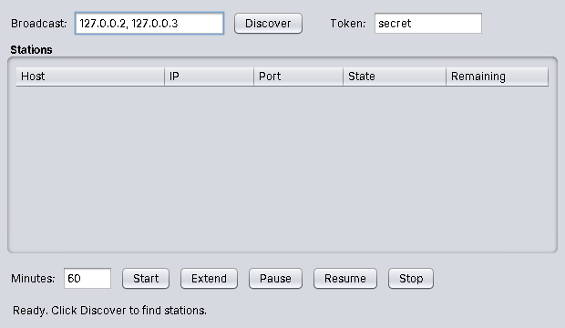
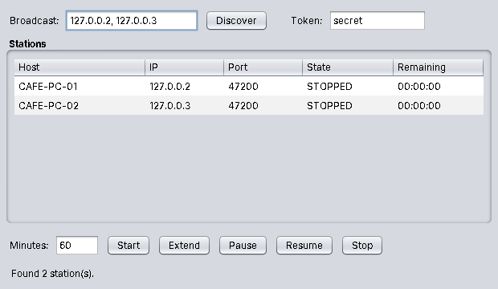
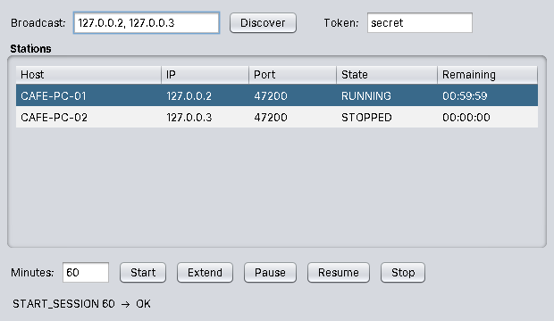
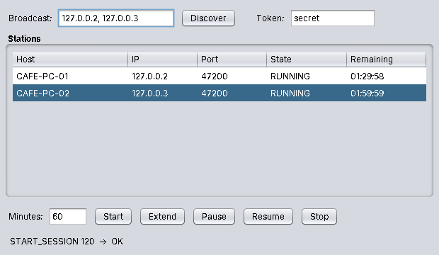
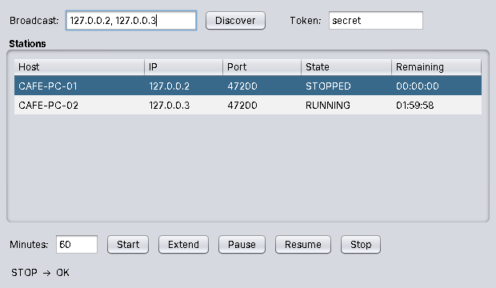

# Cafe Timer

[](LICENSE)

A LAN-controlled session timer for gaming cafes. A Windows service owns a
crash-safe countdown for each station; an in-session agent detects games
and draws the remaining time **inside the game** via a Direct3D 9 overlay,
and on the desktop when no game is covering the screen. A small, dependency
-free Java client discovers stations on the network and starts, extends,
pauses, or stops their sessions.

Built for the Command & Conquer era titles (Generals, Zero Hour, C&C 3,
Kane's Wrath) but game-agnostic — any Direct3D 9 title can be added to the
config.

## How it works

`TimerService.exe` runs as a Windows service (LocalSystem) and is the
single source of truth for every session. It stores only the absolute
moment a session ends (as a UTC `FILETIME`), so remaining time is always
computed fresh — a crash, a force-kill, or a full power loss can't desync
it, and the service auto-restarts itself. It answers a plain-text TCP
control protocol and announces itself over UDP so the Java side can find it
without any hard-coded addresses.

Because a service in Session 0 can't touch the interactive desktop, it
launches `Agent.exe` into the logged-in user's session (`CreateProcessAsUser`)
and keeps it alive. The Agent watches for configured games and, when one
appears, injects `hook.dll` to draw the timer inside the game's own frames
(an inline `EndScene` hook via MinHook, with `Reset`/`ResetEx` handling so
alt-tab and resolution changes don't crash the game). It also hosts an
always-on-top desktop overlay that hides itself while the in-game overlay
is confirmed drawing, so you never see two timers at once.

Injection is architecture-aware: the Agent detects each game's bitness and
uses a matching helper (`injhelper32`/`injhelper64`) with the matching hook
(`hook32.dll`/`hook64.dll`), so a single 64-bit agent services both 32- and
64-bit games.

## Components

- **TimerService.exe** — Windows service: crash-safe session state, UDP
  discovery, TCP control server, and agent supervision.
- **Agent.exe** — runs in the user session: game detection, architecture
  -aware injection, and the desktop overlay.
- **hook.dll** (`hook32`/`hook64`) — injected into the game, draws the
  in-game Direct3D 9 overlay and polls the service for the live time.
- **injhelper.exe** (`injhelper32`/`injhelper64`) — tiny bitness-matched
  injector the Agent launches so cross-architecture injection works.
- **injector.exe / watcher.exe** — standalone manual tools for testing
  injection without the service.
- **Java client** (`CafeTimerClient`) — discovery + control over the wire
  protocol, with a CLI and an optional Swing panel (`CafeTimerUI`).

## Screenshots

The Java control panel discovering stations and driving their sessions.

| | |
|---|---|
|  |  |
| **Startup** — before discovery | **Discovered** — two stations found |
|  |  |
| **Running** — a 60-minute session counting down | **Paused** — countdown frozen |
|  |  |
| **Two running** — one extended by 30 min, one at 120 | **Mixed** — one stopped, one still running |

## Building

Needs MinGW-w64 (gcc + windres), e.g. via MSYS2. Injection is
architecture-aware, so a full install needs **both** bitnesses of the
injected pieces.

```bat
:: from an MSYS2 MINGW32 shell  (builds hook32.dll, injhelper32.exe, injector.exe, watcher.exe)
build32.bat

:: from an MSYS2 MINGW64 shell  (builds hook64.dll, injhelper64.exe, Agent.exe, TimerService.exe)
build64.bat
```

`build.bat` builds everything in one go if both cross-compilers
(`i686-w64-mingw32-gcc`, `x86_64-w64-mingw32-gcc`) are on `PATH`.

The Java side is plain JDK (Java 8+), no dependencies:

```bat
cd java
javac -d out src\CafeTimerClient.java src\CafeTimerUI.java src\ProtocolTest.java
java -cp out ProtocolTest      :: headless self-test, 20 protocol checks
```

## Installing and running

Put `TimerService.exe`, `Agent.exe`, `hook32.dll`, `hook64.dll`,
`injhelper32.exe`, `injhelper64.exe` and `games.cfg` in one folder on each
station, then (as Administrator):

```bat
TimerService.exe install
sc start CafeTimer
```

The service auto-starts on boot, launches the Agent into the active
session, and supervises it. `games.cfg` lists the game executables to watch
(one per line; `#` for comments).

Control a station from the Java client:

```bat
java -cp out CafeTimerClient discover
java -cp out CafeTimerClient send <ip> --token <token> START_SESSION 60
java -cp out CafeTimerClient status <ip>
```

Or use the Swing panel: `java -cp out CafeTimerUI`.

## Control protocol

Plain-text, one command per line on TCP port **47200**; discovery is UDP
port **47100**. `GET_STATUS` is always open; state-changing commands
require a prior `AUTH` when a token is configured (see Security).

| Command | Reply |
|---|---|
| `AUTH <token>` | `OK` / `ERR bad token` |
| `GET_STATUS` | `STATUS <RUNNING\|PAUSED\|STOPPED> <seconds>` |
| `START_SESSION <minutes>` | `OK` / `ERR minutes out of range (1..100000)` |
| `EXTEND <minutes>` | `OK` |
| `PAUSE` | `OK` / `ERR not running` |
| `RESUME` | `OK` / `ERR not paused` |
| `STOP` | `OK` |

## Security

The control server is reachable on the LAN, so it supports an optional
shared secret. Put a token on the first line of `control_token.cfg` next to
`TimerService.exe` on every station (see `control_token.cfg.example`), and
state-changing commands then require `AUTH <token>` first. If the file is
absent the server runs open (and logs a warning). The UDP/TCP ports and the
discovery handshake are a fixed wire contract shared with the client.

The system uses DLL injection and API hooking to draw inside games. That is
the same technique anti-cheat systems watch for, so test against the
specific titles you intend to run before deploying.

## License

MIT — see [LICENSE](LICENSE).
